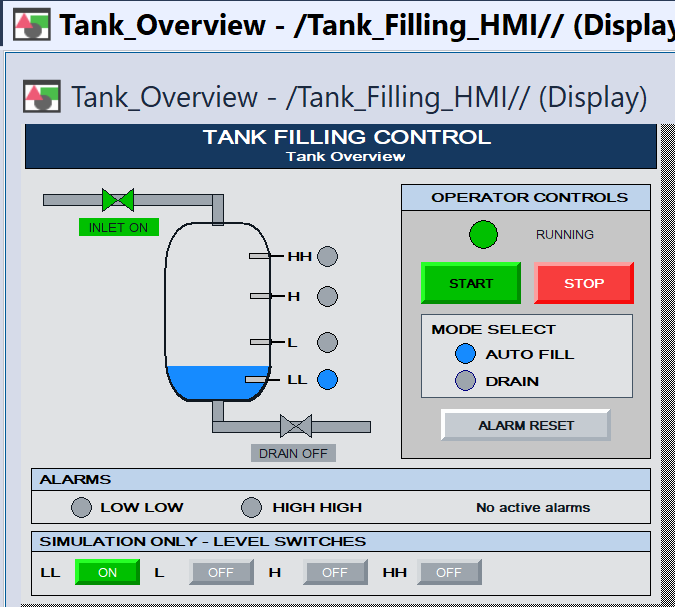

# Tank Filling Control System

A simulated tank-filling control system built with **Studio 5000 Logix Designer**, **Studio 5000 Logix Emulate**, and **FactoryTalk View Machine Edition**. The project demonstrates automatic filling and draining, discrete level sensing, latched alarms, interlocked outputs, and an operator HMI.



## Features

- Start/stop seal-in control for the system run command
- Automatic filling until the high-level switch is reached
- Drain mode with low-low level protection
- Interlocked inlet and drain outputs
- Discrete LL, L, H, and HH level indication
- Two-second low-low and high-high alarm delays
- Latched alarms with condition-aware reset logic
- HMI controls for start, stop, mode selection, alarm reset, and level-switch simulation
- Animated tank level, valves, status lamps, and alarm indications

## Software

- Studio 5000 Logix Designer, version 33
- Studio 5000 Logix Emulate / Emulate 5570
- FactoryTalk View Studio Machine Edition
- FactoryTalk Linx

## Repository contents

| Path | Description |
| --- | --- |
| `Tank_Filling.ACD` | Studio 5000 controller project |
| `Tank_Filling_HMI.mer` | FactoryTalk View ME runtime application |
| `HMI_Images/Toggle_OFF.png` | OFF-state toggle-chip graphic |
| `HMI_Images/Toggle_ON.png` | ON-state toggle-chip graphic |
| `docs/images/tank-overview.png` | HMI screenshot used in this README |

The editable FactoryTalk View application is stored in FactoryTalk View Studio's local application repository. The included `.MER` file is the compiled runtime application.

## Controller configuration

The project uses an **Emulate 5570 controller** in **virtual backplane slot 3**. In FactoryTalk View, the device shortcut is:

```text
TankPLC -> FactoryTalk Linx -> 1789-A17 Backplane -> Slot 3
```

Use the same path for both **Design (Local)** and **Runtime (Target)** communication configurations.

## Main controller tags

| Category | Tags |
| --- | --- |
| Level switches | `Level_LL`, `Level_L`, `Level_H`, `Level_HH` |
| Operator commands | `Start_PB`, `Stop_Request`, `Drain_Mode`, `Alarm_Reset` |
| Control states | `System_Run`, `Fill_Request`, `Drain_Request` |
| Outputs | `Inlet_Output`, `Drain_Output`, `Alarm_Output` |
| Alarms | `Alarm_LL`, `Alarm_HH` |

## Running the simulation

1. Start **Studio 5000 Logix Emulate**.
2. Create or verify an **Emulate 5570** controller in slot `3`.
3. Open `Tank_Filling.ACD` in Studio 5000 Logix Designer.
4. Select the emulator at `Backplane\3`, download the project, and place the controller in **Remote Run**.
5. Open the FactoryTalk View ME application and verify that the `TankPLC` shortcut points to slot `3`.
6. Open `Tank_Overview` and select **Test Display**, or run `Tank_Filling_HMI.mer` with FactoryTalk View ME Station.
7. Use the simulation switches in this physical order:
   - Rising level: `LL -> L -> H -> HH`
   - Falling level: `HH -> H -> L -> LL`

## Operating sequence

1. Select **AUTO FILL** and press **START**.
2. The inlet output runs while the tank fills.
3. Turn on the level switches from LL through H as the displayed level rises.
4. The inlet stops when the H switch becomes active. HH provides the high-high alarm condition.
5. Select **DRAIN** to operate the drain output.
6. Turn off the level switches from HH through LL as the level falls.
7. Clear the alarm condition before pressing **ALARM RESET**.

## Alarm behavior

- `Alarm_LL` latches when the LL switch remains off for two seconds.
- `Alarm_HH` latches when the HH switch remains on for two seconds.
- Alarm Reset clears an alarm only after its initiating condition has returned to normal.

## Notes

- This project is intended for software simulation and training.
- The `.MER` runtime version must be compatible with the installed FactoryTalk View ME Station version.
- If the emulator remains in **Power Up** or **Restoring Image**, remove and recreate the emulator module after saving the controller project.

